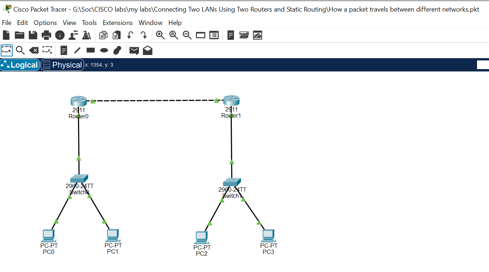
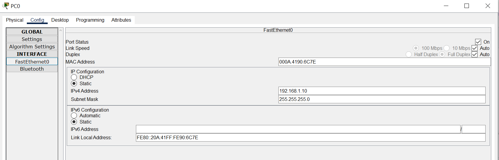
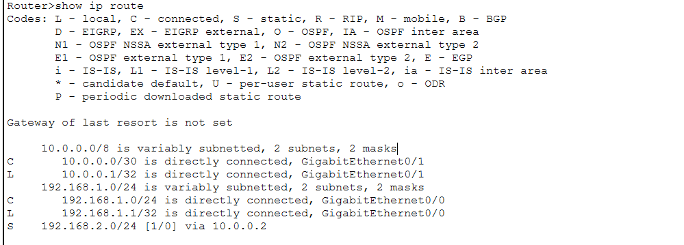
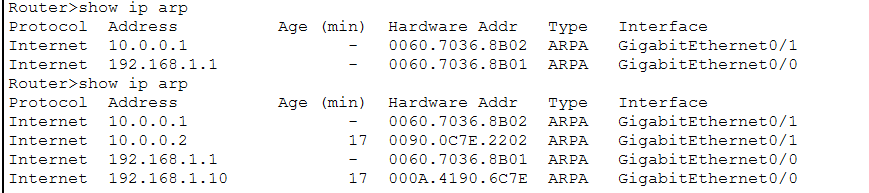
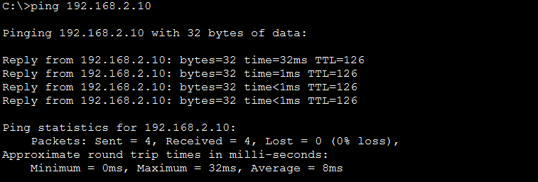

# Connecting Two LANs Using Two Routers and Static Routing

## 1. Overview

This lab demonstrates how to connect two separate Local Area Networks (LANs) using two Cisco routers and static routing.

The network consists of four PCs, two switches, and two routers. Each LAN has its own IPv4 subnet. The routers are connected through an Ethernet link using a point-to-point transit subnet.

Static routes are manually configured on both routers to enable communication between devices in different networks.

The lab was built and tested using Cisco Packet Tracer.

## 2. Objectives

- Build a network topology consisting of two LANs connected by two routers.
- Configure IPv4 addresses and subnet masks on network devices.
- Configure default gateways on PCs.
- Configure router interfaces.
- Establish connectivity between the two routers.
- Configure static routes on both routers.
- Verify end-to-end connectivity between devices in different LANs.

## 3. Network Topology



The network consists of:

- 4 PCs
- 2 Cisco switches
- 2 Cisco routers
- 2 LAN subnets
- 1 Ethernet link connecting both routers using the `10.0.0.0/30` transit subnet

### Network Layout

```text
PC0 ---\
        Switch1 --- R1 --- R2 --- Switch2 --- PC2
PC1 ---/                                  \--- PC3
```

## 4. IP Addressing Table

### LAN 1 — `192.168.1.0/24`

| Device | Interface | IP Address | Subnet Mask | Default Gateway |
|---|---|---|---|---|
| PC0 | FastEthernet0 | 192.168.1.10 | 255.255.255.0 | 192.168.1.1 |
| PC1 | FastEthernet0 | 192.168.1.11 | 255.255.255.0 | 192.168.1.1 |
| R0 | GigabitEthernet0/0 | 192.168.1.1 | 255.255.255.0 | — |

### Transit Network — `10.0.0.0/30`

| Device | Interface | IP Address | Subnet Mask |
|---|---|---|---|
| R0 | GigabitEthernet0/1 | 10.0.0.1 | 255.255.255.252 |
| R1 | GigabitEthernet0/1 | 10.0.0.2 | 255.255.255.252 |

### LAN 2 — `192.168.2.0/24`

| Device | Interface | IP Address | Subnet Mask | Default Gateway |
|---|---|---|---|---|
| PC2 | FastEthernet0 | 192.168.2.10 | 255.255.255.0 | 192.168.2.1 |
| PC3 | FastEthernet0 | 192.168.2.11 | 255.255.255.0 | 192.168.2.1 |
| R1 | GigabitEthernet0/1 | 192.168.2.1 | 255.255.255.0 | — |

## 5. Configuration

### Router R0

Configure the interfaces and assign IP addresses:

```text
Router1> enable
Router1# configure terminal

Router1(config)# interface GigabitEthernet 0/1
Router1(config-if)# ip address 10.0.0.1 255.255.255.252
Router1(config-if)# no shutdown
Router1(config-if)# exit

Router1(config)# interface GigabitEthernet 0/0
Router1(config-if)# ip address 192.168.1.1 255.255.255.0
Router1(config-if)# no shutdown
Router1(config-if)# exit
```

Configure a static route to LAN 2:

```text
Router1(config)# ip route 192.168.2.0 255.255.255.0 10.0.0.2
Router1(config)# end
```

### Router R1

Configure the interfaces and assign IP addresses:

```text
Router2> enable
Router2# configure terminal

Router2(config)# interface GigabitEthernet 0/0
Router2(config-if)# ip address 192.168.2.1 255.255.255.0
Router2(config-if)# no shutdown
Router2(config-if)# exit

Router2(config)# interface GigabitEthernet 0/1
Router2(config-if)# ip address 10.0.0.2 255.255.255.252
Router2(config-if)# no shutdown
Router2(config-if)# exit
```

Configure a static route to LAN 1:

```text
Router2(config)# ip route 192.168.1.0 255.255.255.0 10.0.0.1
Router2(config)# end
```

### PCs

Configure the following IPv4 settings on the PCs:

| PC | Interface | IP Address | Subnet Mask | Default Gateway |
|---|---|---|---|---|
| PC0 | FastEthernet0 | 192.168.1.10 | 255.255.255.0 | 192.168.1.1 |
| PC1 | FastEthernet0 | 192.168.1.11 | 255.255.255.0 | 192.168.1.1 |
| PC2 | FastEthernet0 | 192.168.2.10 | 255.255.255.0 | 192.168.2.1 |
| PC3 | FastEthernet0 | 192.168.2.11 | 255.255.255.0 | 192.168.2.1 |



## 6. Verification and Testing

The following Cisco IOS commands were used to verify the network configuration.

### Interface Status

Command:

```text
show ip interface brief
```

Output from R0:

```text
Router>show ip interface brief
Interface              IP-Address      OK? Method Status                Protocol 
GigabitEthernet0/0     192.168.1.1     YES manual up                    up 
GigabitEthernet0/1     10.0.0.1        YES manual up                    up 
GigabitEthernet0/2     unassigned      YES unset  administratively down down 
Vlan1                  unassigned      YES unset  administratively down down
```

Both router interfaces are operational (`up/up`).

### Routing Table



Command:

```text
show ip route
```

Output from R0:

```text
Gateway of last resort is not set

     10.0.0.0/8 is variably subnetted, 2 subnets, 2 masks
C       10.0.0.0/30 is directly connected, GigabitEthernet0/1
L       10.0.0.1/32 is directly connected, GigabitEthernet0/1
     192.168.1.0/24 is variably subnetted, 2 subnets, 2 masks
C       192.168.1.0/24 is directly connected, GigabitEthernet0/0
L       192.168.1.1/32 is directly connected, GigabitEthernet0/0
S    192.168.2.0/24 [1/0] via 10.0.0.2
```

The routing table confirms:

- `C` — directly connected networks.
- `L` — local interface addresses.
- `S` — statically configured routes.

The static route to `192.168.2.0/24` points to the next-hop address `10.0.0.2` (R1).

### ARP Table



Command:

```text
show ip arp
```

Output from R0:

```text
Router>show ip arp
Protocol  Address          Age (min)  Hardware Addr   Type   Interface
Internet  10.0.0.1                -   0060.7036.8B02  ARPA   GigabitEthernet0/1
Internet  192.168.1.1             -   0060.7036.8B01  ARPA   GigabitEthernet0/0
Router>show ip arp
Protocol  Address          Age (min)  Hardware Addr   Type   Interface
Internet  10.0.0.1                -   0060.7036.8B02  ARPA   GigabitEthernet0/1
Internet  10.0.0.2                17  0090.0C7E.2202  ARPA   GigabitEthernet0/1
Internet  192.168.1.1             -   0060.7036.8B01  ARPA   GigabitEthernet0/0
Internet  192.168.1.10            17  000A.4190.6C7E  ARPA   GigabitEthernet0/0
```


### Connectivity Test

Connectivity was tested between devices located in different LANs.



A ping test was performed from PC0 (LAN 1) to PC2 (LAN 2):

```text
C:\> ping 192.168.2.10

Pinging 192.168.2.10 with 32 bytes of data:

Reply from 192.168.2.10: bytes=32 time<1ms TTL=126
Reply from 192.168.2.10: bytes=32 time<1ms TTL=126
Reply from 192.168.2.10: bytes=32 time<1ms TTL=126
Reply from 192.168.2.10: bytes=32 time<1ms TTL=126

Ping statistics for 192.168.2.10:
    Packets: Sent = 4, Received = 4, Lost = 0 (0% loss),

Approximate round trip times in milli-seconds:
    Minimum = 0ms, Maximum = 0ms, Average = 0ms
```

The successful ping test confirms that ICMP Echo Requests and Echo Replies were successfully routed between the two LANs through the transit network.

## 7. Results

Successfully established communication between two separate LANs using static routing.

End-to-end connectivity was verified by successfully pinging PC2 (`192.168.2.10`) from PC0 (`192.168.1.10`).

The ping test completed with 4 packets sent, 4 received, and 0% packet loss.

## 8. Key Learnings

- IPv4 addressing and subnet masks.
- Default gateways.
- Basic router and switch configuration.
- Router interface configuration.
- Static routing.
- Routing table interpretation.
- ARP address resolution.
- ICMP and ping testing.
- Difference between Layer 2 switching and Layer 3 routing.
- Basic network troubleshooting.

## 9. Tools Used

- Cisco Packet Tracer
- Cisco IOS CLI

