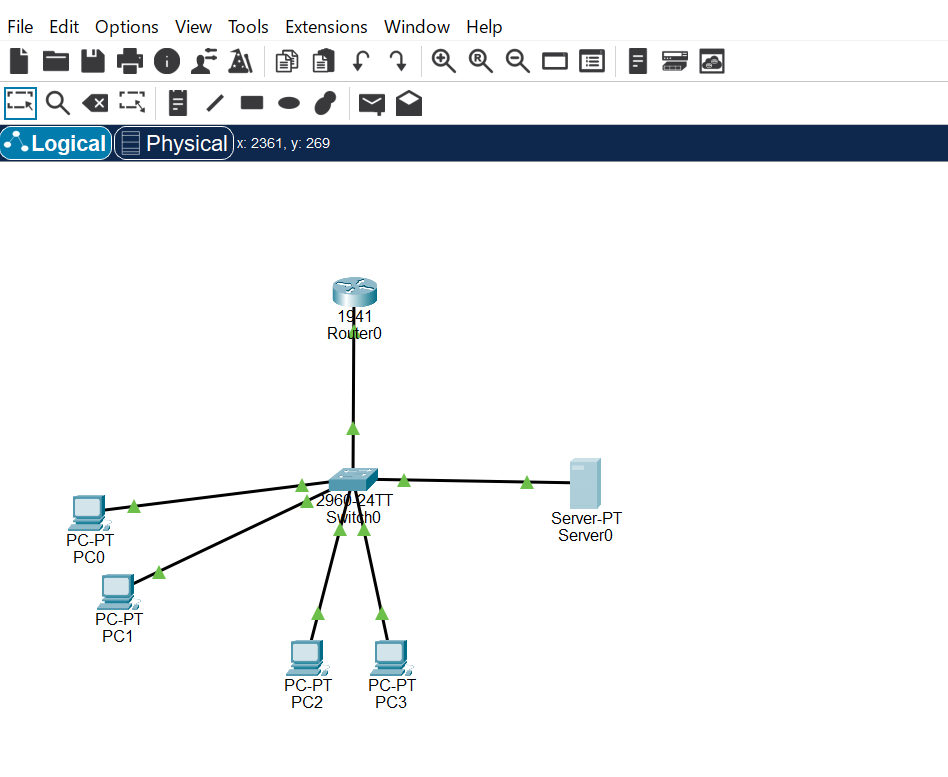
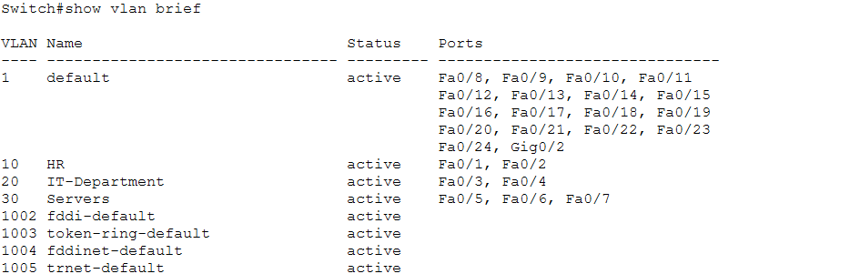
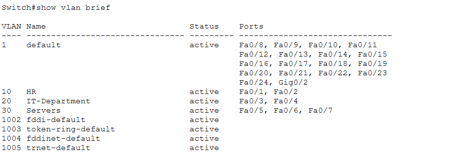
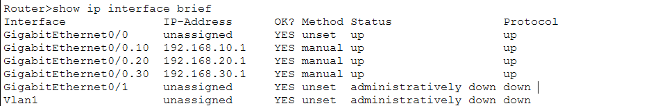
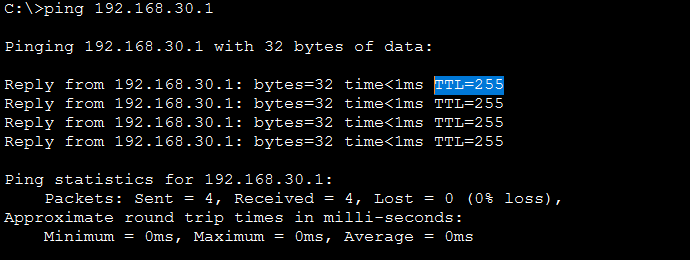
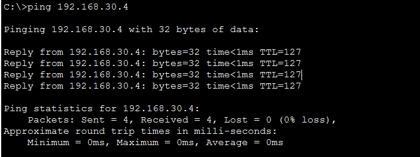
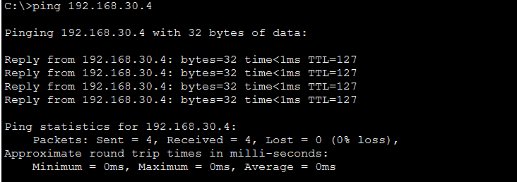
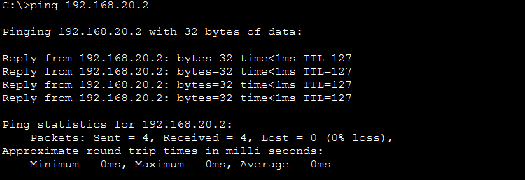

# Configure Trunks with Router-on-a-Stick

**Level:** Beginner  
**Type:** Step-by-step practical lab  
**Technology:** Cisco Packet Tracer, VLANs, 802.1Q Trunking, Inter-VLAN Routing

---

## 1. Lab Objective

This lab demonstrates how to configure **Router-on-a-Stick** to provide Inter-VLAN routing between three separate VLANs using a single physical interface on the router.

### What I will learn

- Creating VLANs on a Cisco switch
- Assigning switch ports to specific VLANs
- Configuring access ports
- Assigning IP addresses and default gateways to end devices
- Configuring a trunk port using IEEE 802.1Q
- Configuring router sub-interfaces
- Implementing Inter-VLAN routing
- Verifying connectivity between different VLANs
- Understanding TTL changes when traffic passes through a router

---

## 2. Network Topology

The network consists of:

- 1 Cisco router
- 1 Cisco switch
- 4 PCs
- 1 server
- 3 VLANs



### VLAN and IP Addressing Plan

| Device | VLAN | IP Address | Subnet Mask | Default Gateway |
|---|---:|---|---|---|
| PC0 | 10 | 192.168.10.2 | 255.255.255.0 | 192.168.10.1 |
| PC1 | 10 | 192.168.10.3 | 255.255.255.0 | 192.168.10.1 |
| PC2 | 20 | 192.168.20.2 | 255.255.255.0 | 192.168.20.1 |
| PC3 | 20 | 192.168.20.3 | 255.255.255.0 | 192.168.20.1 |
| Server0 | 30 | 192.168.30.4 | 255.255.255.0 | 192.168.30.1 |

> **Note:** These IP addresses are part of my chosen addressing plan. They are examples and are not mandatory.

### VLAN Assignment

| VLAN | Name | Network |
|---:|---|---|
| 10 | HR | 192.168.10.0/24 |
| 20 | IT-Department | 192.168.20.0/24 |
| 30 | Servers | 192.168.30.0/24 |

---

## 3. Step 1 — Create VLANs on the Switch

By default, access ports on a Cisco switch are assigned to **VLAN 1**.

I created three VLANs: VLAN 10, VLAN 20, and VLAN 30.

```text
Switch> enable
Switch# configure terminal

! Create VLAN 10
Switch(config)# vlan 10
Switch(config-vlan)# name HR
Switch(config-vlan)# exit

! Create VLAN 20
Switch(config)# vlan 20
Switch(config-vlan)# name IT-Department
Switch(config-vlan)# exit

! Create VLAN 30
Switch(config)# vlan 30
Switch(config-vlan)# name Servers
Switch(config-vlan)# exit
```

### Verification

```text
Switch(config)# show vlan brief
```



The output should show VLANs 10, 20, and 30 with their assigned names.

---

## 4. Step 2 — Assign Switch Ports to VLANs

The access ports are assigned as follows:

| Switch Port | VLAN | Device |
|---|---:|---|
| Fa0/1 | 10 | PC0 |
| Fa0/2 | 10 | PC1 |
| Fa0/3 | 20 | PC2 |
| Fa0/4 | 20 | PC3 |
| Fa0/5 | 30 | Server0 |
| Gi0/1 | Trunk | Router |

### VLAN 10 — HR

```text
Switch(config)# interface range FastEthernet 0/1 - 2
Switch(config-if-range)# switchport mode access
Switch(config-if-range)# switchport access vlan 10
Switch(config-if-range)# exit
```

### VLAN 20 — IT-Department

```text
Switch(config)# interface range FastEthernet 0/3 - 4
Switch(config-if-range)# switchport mode access
Switch(config-if-range)# switchport access vlan 20
Switch(config-if-range)# exit
```

### VLAN 30 — Servers

```text
Switch(config)# interface FastEthernet 0/5
Switch(config-if)# switchport mode access
Switch(config-if)# switchport access vlan 30
Switch(config-if)# exit
```

### Verification

```text
Switch(config)# show vlan brief
```



The output should show the correct access ports assigned to VLANs 10, 20, and 30.

---

## 5. Step 3 — Configure IP Addresses on End Devices

The IP addresses and default gateways are configured manually on each PC and the server.

### IP Configuration

| Device | IP Address | Subnet Mask | Default Gateway |
|---|---|---|---|
| PC0 | 192.168.10.2 | 255.255.255.0 | 192.168.10.1 |
| PC1 | 192.168.10.3 | 255.255.255.0 | 192.168.10.1 |
| PC2 | 192.168.20.2 | 255.255.255.0 | 192.168.20.1 |
| PC3 | 192.168.20.3 | 255.255.255.0 | 192.168.20.1 |
| Server0 | 192.168.30.4 | 255.255.255.0 | 192.168.30.1 |

The default gateway for each device is the router sub-interface belonging to its VLAN.

For example:

- VLAN 10 → `192.168.10.1`
- VLAN 20 → `192.168.20.1`
- VLAN 30 → `192.168.30.1`

---

## 6. Step 4 — Configure the Trunk Port

The switch port connected to the router must operate as a **trunk port** because it needs to carry traffic from multiple VLANs over a single physical link.

The connection is:

```text
Switch Gi0/1 <------> Router Gi0/0
```

### Switch Configuration

```text
Switch> enable
Switch# configure terminal

Switch(config)# interface GigabitEthernet 0/1
Switch(config-if)# switchport mode trunk
Switch(config-if)# exit
```

### Verify the Trunk

```text
Switch# show interfaces trunk
```

This command verifies that `GigabitEthernet0/1` is operating as a trunk.

---

## 7. Step 5 — Configure Router-on-a-Stick

Router-on-a-Stick uses multiple **logical sub-interfaces** on a single physical router interface.

Each sub-interface is associated with one VLAN and acts as the default gateway for that VLAN.

### Enable the Physical Interface

```text
Router> enable
Router# configure terminal

Router(config)# interface GigabitEthernet 0/0
Router(config-if)# no shutdown
```

The physical interface must be enabled before the sub-interfaces can operate.

---

### Configure VLAN 10 Sub-interface

```text
Router(config)# interface GigabitEthernet 0/0.10
Router(config-subif)# encapsulation dot1Q 10
Router(config-subif)# ip address 192.168.10.1 255.255.255.0
Router(config-subif)# exit
```

This sub-interface is the default gateway for VLAN 10.

---

### Configure VLAN 20 Sub-interface

```text
Router(config)# interface GigabitEthernet 0/0.20
Router(config-subif)# encapsulation dot1Q 20
Router(config-subif)# ip address 192.168.20.1 255.255.255.0
Router(config-subif)# exit
```

This sub-interface is the default gateway for VLAN 20.

---

### Configure VLAN 30 Sub-interface

```text
Router(config)# interface GigabitEthernet 0/0.30
Router(config-subif)# encapsulation dot1Q 30
Router(config-subif)# ip address 192.168.30.1 255.255.255.0
Router(config-subif)# exit

Router(config-subif)# end
```

This sub-interface is the default gateway for VLAN 30.

---

### Verify Router Interfaces

```text
Router# show ip interface brief
```



The expected result is that the physical interface and all three sub-interfaces are operational:

```text
GigabitEthernet0/0       up    up
GigabitEthernet0/0.10    up    up
GigabitEthernet0/0.20    up    up
GigabitEthernet0/0.30    up    up
```

---

## 8. Step 6 — Verify Connectivity

After configuring the VLANs, trunk, router sub-interfaces, and end devices, connectivity can be tested using `ping`.

### Test 1 — Server to VLAN 30 Gateway

The server belongs to VLAN 30 and uses `192.168.30.1` as its default gateway.

```text
C:\>ping 192.168.30.1

Pinging 192.168.30.1 with 32 bytes of data:

Reply from 192.168.30.1: bytes=32 time<1ms TTL=255
Reply from 192.168.30.1: bytes=32 time<1ms TTL=255
Reply from 192.168.30.1: bytes=32 time<1ms TTL=255
Reply from 192.168.30.1: bytes=32 time<1ms TTL=255

Ping statistics for 192.168.30.1:
    Packets: Sent = 4, Received = 4, Lost = 0 (0% loss),
```



The successful replies confirm connectivity between the server and its default gateway.

---

### Test 2 — PC0 (VLAN 10) to Server (VLAN 30)

```text
C:\>ping 192.168.30.4

Pinging 192.168.30.4 with 32 bytes of data:

Reply from 192.168.30.4: bytes=32 time<1ms TTL=127
Reply from 192.168.30.4: bytes=32 time<1ms TTL=127
Reply from 192.168.30.4: bytes=32 time<1ms TTL=127
Reply from 192.168.30.4: bytes=32 time<1ms TTL=127

Ping statistics for 192.168.30.4:
    Packets: Sent = 4, Received = 4, Lost = 0 (0% loss),
```



The source and destination are in different IP networks:

```text
PC0     192.168.10.2/24
Server  192.168.30.4/24
```

Therefore, the traffic must be routed by the router.

---

### Test 3 — PC2 (VLAN 20) to Server (VLAN 30)

```text
C:\>ping 192.168.30.4

Pinging 192.168.30.4 with 32 bytes of data:

Reply from 192.168.30.4: bytes=32 time<1ms TTL=127
Reply from 192.168.30.4: bytes=32 time<1ms TTL=127
Reply from 192.168.30.4: bytes=32 time<1ms TTL=127
Reply from 192.168.30.4: bytes=32 time<1ms TTL=127

Ping statistics for 192.168.30.4:
    Packets: Sent = 4, Received = 4, Lost = 0 (0% loss),
```



This confirms that traffic can be routed from VLAN 20 to VLAN 30.

---

### Test 4 — PC0 (VLAN 10) to PC2 (VLAN 20)

An additional test can be used to verify routing directly between VLAN 10 and VLAN 20:

```text
C:\>ping 192.168.20.2

Pinging 192.168.20.2 with 32 bytes of data:

Reply from 192.168.20.2: bytes=32 time<1ms TTL=127
Reply from 192.168.20.2: bytes=32 time<1ms TTL=127
Reply from 192.168.20.2: bytes=32 time<1ms TTL=127
Reply from 192.168.20.2: bytes=32 time<1ms TTL=127

Ping statistics for 192.168.20.2:
    Packets: Sent = 4, Received = 4, Lost = 0 (0% loss),
Approximate round trip times in milli-seconds:
    Minimum = 0ms, Maximum = 0ms, Average = 0ms
```



The expected result is four successful replies.

This test demonstrates Inter-VLAN routing between two client VLANs.

---

## 9. Understanding TTL

The `TTL` (Time to Live) value is reduced by one when an IP packet passes through a Layer 3 router.

In this lab, Windows end devices use an initial TTL of 128.

For example:

```text
PC0 → Router → Server

128 → 127
```

The value of `127` is consistent with the packet passing through one router.

However, TTL alone should not be considered proof of Inter-VLAN routing. The successful ping between devices in different IP subnets is the primary evidence that routing is working.

The Server-to-Gateway test is different because the server and its gateway belong to the same IP subnet:

```text
Server:  192.168.30.4/24
Gateway: 192.168.30.1/24
```

The destination is therefore on the local subnet.

---

## 10. How Router-on-a-Stick Works

Router-on-a-Stick allows a router to route traffic between multiple VLANs using a **single physical interface**.

In this lab:

```text
                     Router
                  Gi0/0
                     |
                  802.1Q
                   Trunk
                     |
                  Gi0/1
                   Switch
             _______|_______
            |       |       |
          VLAN 10 VLAN 20 VLAN 30
            |       |       |
           PCs     PCs    Server
```

The router uses three logical sub-interfaces:

```text
Gi0/0.10 → VLAN 10 → 192.168.10.1
Gi0/0.20 → VLAN 20 → 192.168.20.1
Gi0/0.30 → VLAN 30 → 192.168.30.1
```

Each sub-interface acts as the default gateway for its corresponding VLAN.

---

## 11. Access Ports vs. Trunk Ports

### Access Port

An access port carries traffic for a single VLAN and is typically used to connect end devices such as:

- PCs
- Servers
- Printers

Example:

```text
FastEthernet0/1 → VLAN 10
```

### Trunk Port

A trunk port carries traffic from multiple VLANs over a single physical connection.

In this lab:

```text
Switch Gi0/1 ↔ Router Gi0/0
```

The trunk uses **IEEE 802.1Q VLAN tagging** to identify the VLAN associated with Ethernet frames.

---

## 12. Why Inter-VLAN Routing Is Required

VLANs provide logical separation at Layer 2.

For example:

```text
VLAN 10 → 192.168.10.0/24
VLAN 20 → 192.168.20.0/24
VLAN 30 → 192.168.30.0/24
```

Devices in different VLANs are also in different IP subnets.

A Layer 3 device is therefore required to route traffic between these networks.

In this lab, the router performs this function.

```text
VLAN 10
192.168.10.0/24
       |
       | Router
       |
VLAN 20
192.168.20.0/24
       |
       | Router
       |
VLAN 30
192.168.30.0/24
```

---

## 13. Limitations of Router-on-a-Stick

Router-on-a-Stick is simple and cost-effective for small networks, but it has limitations.

All Inter-VLAN traffic must pass through a single physical link between the switch and router.

As traffic increases, this link can become a bottleneck.

For larger networks, a **Layer 3 switch** is often a better solution because Inter-VLAN routing can be performed directly on the switch at higher throughput.

---

## 14. What I Learned

After completing this lab, I understand the following concepts:

### 1. VLAN Segmentation

VLANs logically separate devices into different Layer 2 broadcast domains.

### 2. Access Ports

Access ports are used to connect end devices to a specific VLAN.

### 3. Trunking

A trunk allows multiple VLANs to travel across a single physical link using IEEE 802.1Q tagging.

### 4. Router-on-a-Stick

A single router interface can provide routing for multiple VLANs by using logical sub-interfaces.

### 5. Default Gateways

Each VLAN requires a Layer 3 gateway. In this lab, the router sub-interfaces provide those gateways:

```text
VLAN 10 → 192.168.10.1
VLAN 20 → 192.168.20.1
VLAN 30 → 192.168.30.1
```

### 6. Inter-VLAN Routing

The router allows devices in different VLANs and IP subnets to communicate.

### 7. Network Verification

Commands such as:

```text
show vlan brief
show interfaces trunk
show ip interface brief
ping
```

can be used to verify the configuration and connectivity.

---

## 15. Summary

This lab demonstrates how to configure VLANs, access ports, an 802.1Q trunk, and Router-on-a-Stick Inter-VLAN routing in Cisco Packet Tracer.

The final network uses:

- **3 VLANs**
- **5 end devices**
- **1 trunk link**
- **3 router sub-interfaces**
- **3 default gateways**

The key concept is that a single physical router interface can provide Layer 3 connectivity for multiple VLANs by using logical sub-interfaces and 802.1Q encapsulation.

This approach is suitable for learning and for small networks, while larger environments commonly use Layer 3 switches for Inter-VLAN routing.
