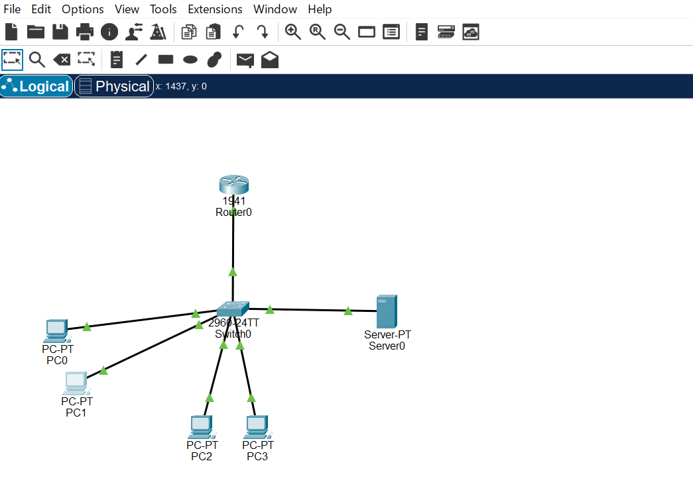
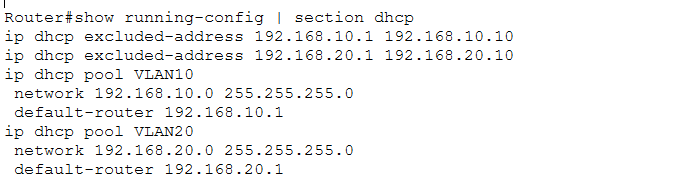
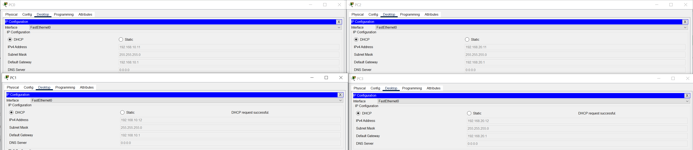
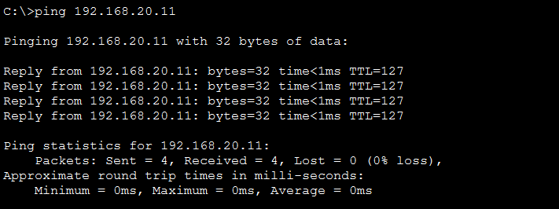
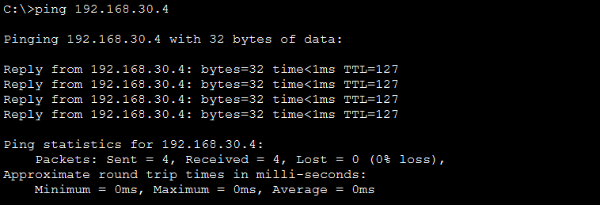

# Cisco DHCP Configuration with VLANs – Packet Tracer Lab

## Project Overview

This lab demonstrates how to configure DHCP on a Cisco Router to automatically assign IP addresses to devices in multiple VLANs using Cisco Packet Tracer.

The existing network infrastructure uses Router-on-a-Stick for Inter-VLAN Routing, allowing DHCP services to operate across multiple subnets.

## Network Topology

**Devices:**
- 1 Cisco Router
- 1 Cisco Switch
- 4 PCs
- 1 Server



**Technologies:**
- DHCP Configuration
- DHCP Address Exclusion
- Multiple DHCP Pools
- VLANs
- IEEE 802.1Q Trunking
- Router-on-a-Stick
- Inter-VLAN Routing
- Static IP Addressing
- ARP
- ICMP / Ping Testing

## IP Addressing Scheme

| VLAN | Name | Network | Default Gateway |
|---|---|---|---|
| 10 | HR | 192.168.10.0/24 | 192.168.10.1 |
| 20 | IT-Department | 192.168.20.0/24 | 192.168.20.1 |
| 30 | Servers | 192.168.30.0/24 | 192.168.30.1 |

## Device Allocation

| Device | VLAN | IP Configuration |
|---|---|---|
| PC0 | VLAN 10 | DHCP |
| PC1 | VLAN 10 | DHCP |
| PC2 | VLAN 20 | DHCP |
| PC3 | VLAN 20 | DHCP |
| Server | VLAN 30 | Static: 192.168.30.4 |

## DHCP Configuration

DHCP runs directly on the Cisco Router.

- VLAN 10 and VLAN 20 use dynamic IP addressing.
- The Server in VLAN 30 uses a manually configured static IP address.
- No DHCP pool is configured for VLAN 30.

### 1. Configure Excluded Addresses

The first ten addresses in each DHCP subnet are excluded from dynamic allocation.

This reserves addresses for gateways and potential statically configured network devices.

```cisco
ip dhcp excluded-address 192.168.10.1 192.168.10.10

ip dhcp excluded-address 192.168.20.1 192.168.20.10
```

### 2. Configure DHCP Pool – VLAN 10

```cisco
ip dhcp pool VLAN10
 network 192.168.10.0 255.255.255.0
 default-router 192.168.10.1
 exit
```

### 3. Configure DHCP Pool – VLAN 20

```cisco
ip dhcp pool VLAN20
 network 192.168.20.0 255.255.255.0
 default-router 192.168.20.1
 exit
```



## PC Configuration

Each PC was configured to obtain its IP address automatically.

Configuration steps:

1. Open Desktop.
2. Select IP Configuration.
3. Select DHCP.

**Example IP addressing:**

| PC | VLAN | Example IP Address | Default Gateway |
|---|---|---|---|
| PC0 | 10 | 192.168.10.11 | 192.168.10.1 |
| PC1 | 10 | 192.168.10.12 | 192.168.10.1 |
| PC2 | 20 | 192.168.20.11 | 192.168.20.1 |
| PC3 | 20 | 192.168.20.12 | 192.168.20.1 |

Actual DHCP addresses may vary depending on the order in which clients request leases.



## Connectivity Testing

Connectivity was tested from PC0 to devices in other VLANs.

**Test commands:**

```text
ping 192.168.20.11
ping 192.168.30.4
```

**PC0 → PC2 (VLAN 20)**



**PC0 → Server (VLAN 30)**



## Test Results

| Test | Result |
|---|---|
| DHCP assignment in VLAN 10 | Successful |
| DHCP assignment in VLAN 20 | Successful |
| DHCP binding verification on Router | Successful |
| Inter-VLAN connectivity: VLAN 10 → VLAN 20 | Successful |
| Inter-VLAN connectivity: VLAN 10 → VLAN 30 | Successful |
| Server static IP connectivity | Successful |

## Key Concepts Learned

- How DHCP dynamically assigns IP addresses to network clients.
- How DHCP excluded addresses prevent allocation of reserved IP addresses.
- How to configure multiple DHCP pools on a Cisco Router.
- How DHCP works across multiple VLANs and subnets.
- How to verify DHCP leases using `show ip dhcp binding`.
- How to test network connectivity using ICMP ping.

## Conclusion

Successfully configured DHCP services on a Cisco Router for two separate VLANs.

Configured DHCP address exclusions, created multiple DHCP pools, assigned IP addresses automatically to client PCs, and verified connectivity between different VLANs and a statically configured server.

**Platform:** Cisco Packet Tracer  
**Focus:** DHCP / CCNA Practice  
**Project Type:** Hands-on Networking Lab
